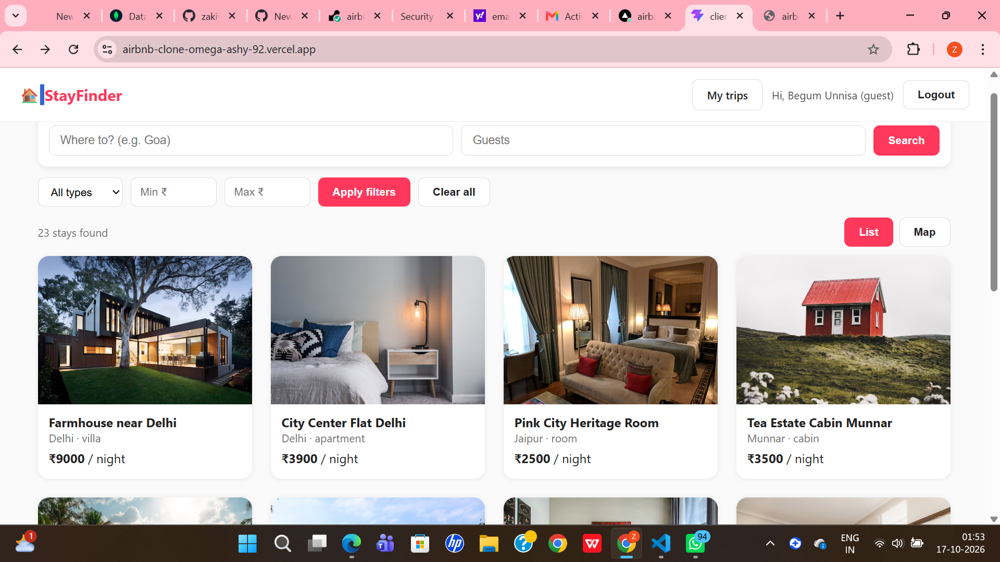
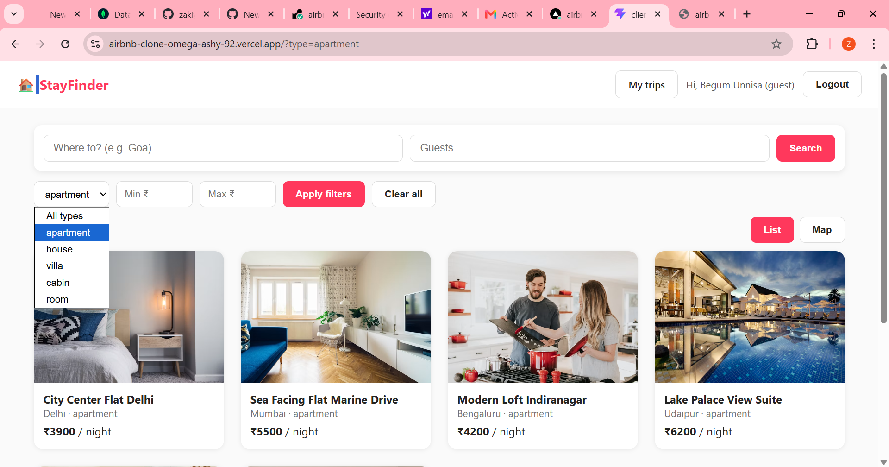
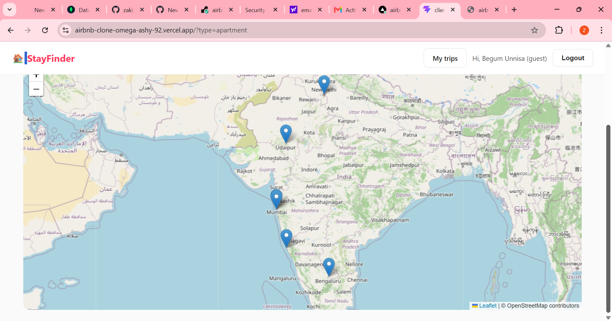
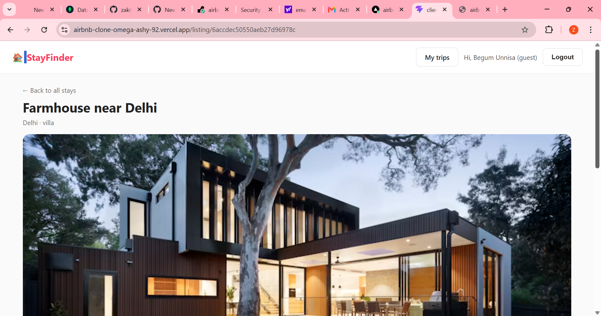
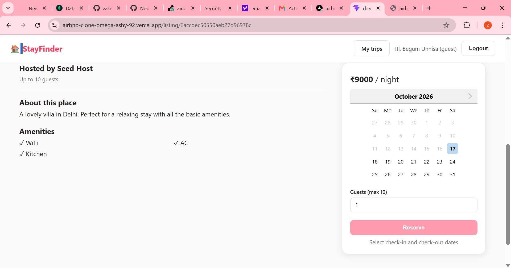
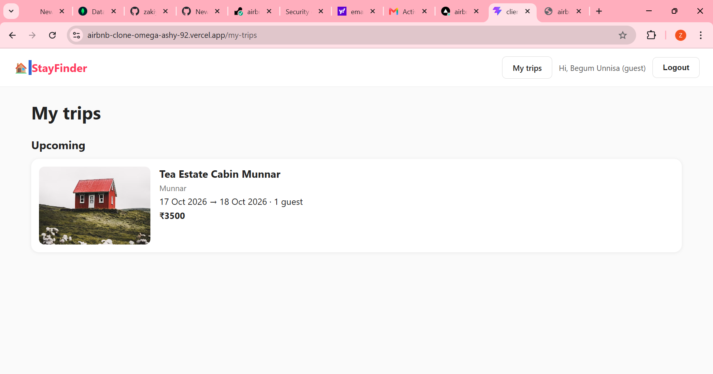
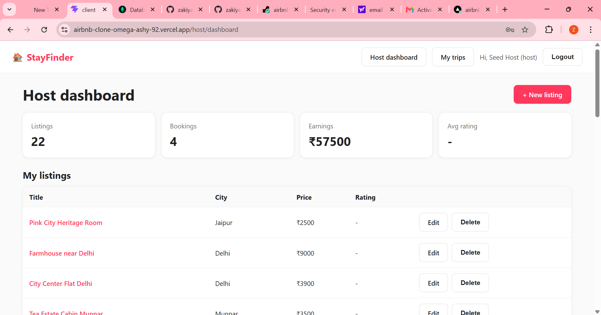

# 🏠 StayFinder: Airbnb Clone (Full Stack)

A full stack listings and booking platform where guests can search and book stays, and hosts can manage their properties. Built as an advanced capstone project with **React, Node.js/Express, MongoDB, JWT and Leaflet maps**.

🔗 **Live Demo:** https://airbnb-clone-omega-ashy-92.vercel.app
🔗 **API Health:** https://airbnb-clone-1-9aw3.onrender.com/api/health

> ⏳ The backend runs on a free tier and sleeps after inactivity. The first request can take 30 to 60 seconds, please wait.

---

## 📸 Screenshots

### Home: search, filters and listings


### Filters


### Map view


### Listing detail


### Booking: date picker with Reserve


### My trips

## ✨ Features

### Host dashboard


**For guests**
- Search by city and guests, filter by type and price range
- Pagination, loading skeletons and empty/error states
- List and Map view of all stays (Leaflet + OpenStreetMap)
- Date picker with already booked dates disabled
- Live price calculation (nights × price)
- Booking confirmation and **My Trips** (upcoming, past, cancelled)
- Reviews and star ratings, allowed only after a completed stay

**For hosts**
- Role based access (guest / host)
- Host dashboard with stats (listings, bookings, earnings, average rating)
- Create, edit and delete listings, with map pin picker for location
- View incoming bookings

**Security and quality**
- JWT authentication with bcrypt password hashing
- Protected routes on both frontend and backend
- Ownership checks (a host can only edit or delete their own listing)
- Helmet, rate limiting, CORS whitelist and compression
- Environment separation for development and production

---

## 🧠 Key Technical Highlights

- **Double booking prevention:** overlap validation (`existing.checkIn < new.checkOut AND existing.checkOut > new.checkIn`) inside a **MongoDB transaction**, so two users cannot book the same dates at the same time.
- **Review aggregation:** the average rating and review count of each listing update automatically using a MongoDB aggregation pipeline.
- **URL based filters:** search and filters live in the URL query string, so they survive refresh and can be shared.
- **Role based UI:** different navigation and pages for guests and hosts, re-checked on the server.

---

## 🛠️ Tech Stack

| Layer | Technology |
|---|---|
| Frontend | React (Vite), React Router, Axios, react-datepicker, Leaflet |
| Backend | Node.js, Express |
| Database | MongoDB Atlas, Mongoose |
| Auth | JWT, bcryptjs |
| Security | helmet, express-rate-limit, cors |
| Deployment | Vercel (frontend), Render (backend), MongoDB Atlas |

---

## 📁 Project Structure

```
airbnb-clone/
├── Server/
│   ├── src/
│   │   ├── controllers/   (auth, listing, booking, review, host)
│   │   ├── middleware/    (auth, error handling)
│   │   ├── models/        (User, Listing, Booking, Review)
│   │   ├── routes/
│   │   └── app.js
│   ├── seed.js
│   └── server.js
└── client/
    └── src/
        ├── api/
        ├── components/
        ├── context/
        ├── pages/
        └── utils/
```

---

## 🔌 API Overview

| Method | Endpoint | Access |
|---|---|---|
| POST | `/api/auth/register`, `/api/auth/login` | Public |
| GET | `/api/auth/me` | Logged in |
| GET | `/api/listings` (filters + pagination) | Public |
| GET | `/api/listings/:id` | Public |
| POST / PUT / DELETE | `/api/listings` | Host (owner) |
| GET | `/api/listings/:id/bookings` | Public (dates only) |
| POST | `/api/bookings` | Logged in |
| GET | `/api/bookings/mine` | Logged in |
| PATCH | `/api/bookings/:id/cancel` | Booking owner |
| GET / POST | `/api/listings/:id/reviews` | Public / Guest with completed stay |
| GET | `/api/host/stats`, `/api/host/bookings` | Host |

---

## 🚀 Run Locally

**Prerequisites:** Node.js v18+, a MongoDB Atlas account.

```bash
# 1. Clone
git clone https://github.com/zakiyakhanum173-debug/airbnb-clone.git
cd airbnb-clone

# 2. Backend
cd Server
cp .env.example .env      # fill in your values
npm install
node seed.js              # optional: adds sample listings
npm run dev

# 3. Frontend (new terminal)
cd client
cp .env.example .env
npm install
npm run dev
```

**Server `.env`**
```
PORT=5000
MONGO_URI=your_mongodb_connection_string
JWT_SECRET=your_long_random_secret
CLIENT_URL=http://localhost:5173
```

**Client `.env`**
```
VITE_API_URL=http://localhost:5000/api
```

Open http://localhost:5173

---

## 🧪 Demo Accounts

| Role | Email | Password |
|---|---|---|
| Host | seedhost@test.com | 123456 |
| Guest | Sign up with any email | any (6+ chars) |

---

## 📚 What I Learned

- Designing a multi-entity data model (users, listings, bookings, reviews)
- Building secure REST APIs with JWT and role based access
- Handling complex logic: overlap validation and database transactions
- Connecting a React frontend to a live API with search, filters and maps
- Deploying a full stack app with separate dev and production environments

---

## 👩‍💻 Author

**Zakiya Khanum**
GitHub: [@zakiyakhanum173-debug](https://github.com/zakiyakhanum173-debug)

Built as part of the SapphireIQ Full Stack Development capstone project.